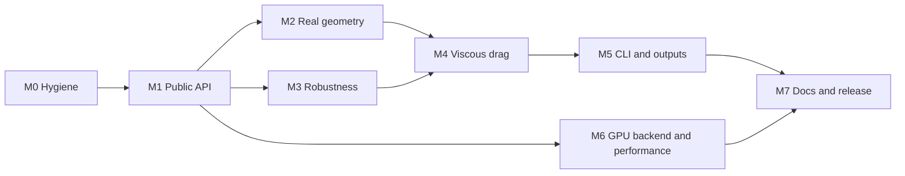

# Bowshock roadmap: from validation harness to a usable tool

## Where it stands

The solver is validated and the numerics are sound, but the only way to use it is to run one of eight
validation binaries on a hard-coded body. There is no public "body in, coefficients out" entry point, the
geometry types live next to experiment tables in `bowshock-cases`, and the output is inviscid pressure drag
only.

## Target

**User:** someone designing a model or sounding rocket who wants a drag curve for a flight simulator and does
not want to learn CFD.

**"Useful" means this works:**

```sh
bowshock polar rocket.toml --mach 0.3:2.5:0.1 -o cd.csv
```

- Input: a dimensional description of an axisymmetric body (nose, tubes, transitions, boattail) and flight
  conditions.
- Output: total zero-lift `CD` vs Mach with a breakdown (forebody pressure, skin friction, base), plus a
  per-point convergence flag and uncertainty estimate.
- No panics, no NaN in the output, no solver knobs required.
- The same thing is available as a Rust API.

## Decisions this plan assumes

Each has a default so work can start; changing one changes the milestones named.

| # | Decision | Default assumed here | If changed |
|---|---|---|---|
| 1 | Angle of attack / normal force / centre of pressure | Out of scope. The solver is axisymmetric; these need 3D flow or an empirical method. | Everything after M1 changes; decide before M2. |
| 2 | Fins | Out of scope for CFD. Body-alone drag only; say so in the output. | Needs 3D or an empirical fin-drag add-on (new milestone). |
| 3 | Viscous model | Correlation first (M4a), integral boundary layer second (M4b). RANS deferred. | RANS replaces M4b and needs a new grid topology. |
| 4 | GPU | Optional backend behind a feature; CPU is the default and the only thing CI runs. | If GPU is mandatory, M6 moves before M5. |

## Milestones



M0 to M5 is the first useful release. M6 makes it fast; M7 makes it findable.

### M0 — Hygiene

Goal: a stranger can clone, build and test, and regressions are caught automatically.

- [ ] Pin Luma to a revision instead of `branch = "main"` (`Cargo.toml`; the lockfile currently has `f29290fb`).
- [ ] Add CI: `cargo fmt --check`, `cargo clippy`, and `cargo test --release` for `bowshock-core`,
      `bowshock-reference`, `bowshock-cases` (47 tests, about 30 s locally). Exclude `bowshock-gpu-cases`,
      which needs a Vulkan device.
- [ ] Add `rustfmt.toml` with the line width the code actually uses, then format once.
- [ ] Remove the `WARMRAMP` environment variable read from `bowshock-cases/src/transonic.rs` (make it a
      parameter or delete it).
- [ ] Fix stale text: `cd cfd` and "28 unit tests" in `bowshock-core/README.md`; `bowshock-cfd` in the
      banner strings of every binary in `bowshock-cli/src/bin/`.
- [ ] Add a test that the Rust `Params` struct and the WGSL `Params` block in `shaders::common` have the
      same size and field order.

Exit: CI is green on a machine without a GPU.

### M1 — Public API

Goal: one crate a user depends on, with a small typed surface. This is the milestone everything else hangs on.

- [ ] New facade crate `bowshock` re-exporting only the user surface.
- [ ] Move `Nose`, `Body`, `BaseBody` and the grid generators out of `bowshock-cases` into a geometry module
      with no dependency on experiment data.
- [ ] One runner for every Mach number. Today `ConeCase`, `OgiveCase`, `TransonicCase` and `SubsonicCase`
      each carry their own grid, scheme, limiter and stop rule. Replace with a single analysis that picks
      scheme, low-Mach correction, limiter and domain from the Mach number, using the settings the
      validation cases already established.
- [ ] Typed results: `StopReason` enum instead of `&'static str` compared by text; a `Convergence` struct
      (iterations, orders dropped, `CD` range over the last window); a crate error type instead of
      `LumaError::InvalidShape` and `panic!`.
- [ ] Make `Solver` fields private where a setter maintains an invariant (`block` / `n_active`, `scheme` /
      multigrid hierarchy).
- [ ] Rebuild the validation cases on top of the new runner so they exercise the same code users run.

Sketch (names open):

```rust
let body = Body::builder()
    .nose(Nose::TangentOgive { fineness: 3.0 })
    .cylinder(6.0)
    .build()?;
let polar = Analysis::new(&body).resolution(Resolution::Medium).run(&[0.5, 0.9, 1.2, 2.0])?;
for p in &polar.points {
    println!("{} {} {:?}", p.mach, p.cd_forebody, p.convergence.stop);
}
```

Exit: the `transonic` and `subsonic` validation tables are reproduced through the public API alone, with
unchanged numbers.

### M2 — Real geometry

Goal: describe an actual rocket, not a unit-diameter nose on a fixed cylinder.

- [ ] Dimensional input (lengths in metres, reference diameter explicit); non-dimensionalise internally.
- [ ] Piecewise body profile: nose, any number of tubes, conical transitions (expanding and contracting),
      boattail, flat base. `BaseBody` already has a boattail and sting; generalise it rather than add a
      second type.
- [ ] Geometry validation with clear errors: non-monotone `x`, zero-length segments, slope discontinuities
      steeper than the grid can take.
- [ ] Blunt and rounded tips. The H-grid has vertical grid lines, so an infinite tip slope is not
      representable as is. Either implement a tip treatment or reject such bodies with an error that says
      why. Decide by measuring how badly a Haack or power-series tip behaves today.
- [ ] Grid sizing from the body: cells per diameter by resolution level, domain extent in body lengths, as
      `TransonicCase::with_body` and `SubsonicCase::with_body` already do.
- [ ] Grid quality check before solving (minimum cell area, maximum stretching ratio).

Exit: three bodies with a transition and a boattail run from Mach 0.3 to 2.5 without manual grid parameters.

### M3 — Robustness and trust

Goal: every point either converges or says why not, and carries an error estimate.

- [ ] Sweep test: a matrix of bodies and Mach numbers must finish with finite output. Run the small version
      in CI and the full one before a release.
- [ ] Per-point quality flag derived from `Convergence` (converged / `CD` stationary / stalled / failed).
      The README already documents residual stall at 3 to 4 orders in subsonic and transonic runs; make
      that visible in the result instead of in prose.
- [ ] Grid-convergence estimate: run two resolution levels and report the difference as an uncertainty.
- [ ] Known weak spots get an explicit treatment or an explicit warning: sharp shoulders below Mach 1.05
      (not grid-converged per the README) and unsteady inviscid wakes behind a blunt base.
- [ ] Warm-started Mach sweeps as the default path (the machinery exists in `transonic::run_on` and
      `subsonic::run_on`), with a cold restart as the fallback when a warm start fails.

Exit: the sweep test passes, and no code path reachable from the public API panics on user input.

### M4 — Viscous drag

Goal: total drag, since pressure drag alone is a small part of subsonic `CD`.

- [ ] **M4a, correlation.** Flat-plate skin friction with a compressibility correction over the wetted
      area, from Reynolds number. Needs flight conditions as input (altitude or density, viscosity, speed
      of sound). Keep the existing base-drag correlation in `bowshock_reference::base_drag` and extend it
      for a boattailed base.
- [ ] **M4b, integral boundary layer.** March a laminar and turbulent integral method along the wall using
      the Euler edge velocity, so pressure gradients affect friction. One-way coupling first; displacement
      feedback only if validation shows it is needed.
- [ ] Report the breakdown: forebody pressure, friction, base, total. Label base and friction as modelled.
- [ ] Validate total `CD` against published total-drag data. The free-flight totals behind the Stoney nose
      series already cited in `transonic.rs` are a starting point.

Exit: total `CD` vs Mach for at least two published configurations, with the error stated next to each.

### M5 — CLI and outputs

Goal: usable without writing Rust.

- [ ] Single `bowshock` binary with subcommands: `polar` (the user path) and `validate <case>` (replaces the
      eight binaries, whose argument parsing and CSV writers are currently duplicated).
- [ ] TOML input file for the body and flight conditions; a real argument parser with `--help`.
- [ ] Output: CSV of Mach, `CD` and its components, quality flag and uncertainty. Confirm the column layout
      against what RocketPy's drag-curve input expects when implementing.
- [ ] Optional wall `Cp` distribution per Mach number, for users who want loads.
- [ ] I/O errors reported, not `unwrap()`ed.

Exit: the command in "Target" works on a fresh checkout following only the README.

### M6 — GPU backend and performance

Goal: the GPU is a switch, not a second codebase, and the speed claims are measured against a fair baseline.

- [ ] `Backend::{Cpu, Gpu}` on the public analysis; `bowshock-gpu` behind a cargo feature so CPU-only users
      do not compile wgpu.
- [ ] Record a baseline first: wall time for a standard sweep on CPU and GPU. Set targets from that.
- [ ] CPU: remove per-iteration allocation in `implicit.rs` (`assemble` allocates the three block arrays
      for both directions every step; the j-line solves gather into per-column vectors) and in
      `Solver::smooth_residual`. Check rayon granularity on small grids.
- [ ] Generate the f32 and double-float WGSL kernels from one source where possible, so a physics change is
      made twice (Rust and WGSL), not three times.
- [ ] Re-measure the speed-up after the CPU work and update `bowshock-gpu/README.md`.

Exit: the same sweep runs on either backend through the same API and agrees within the tolerances already
used in `gpu_vs_cpu.rs`.

### M7 — Docs and release

- [ ] Root README becomes a user guide: install, one worked example, what the numbers mean, limits.
- [ ] Move the two long crate READMEs (54 KB and 79 KB of measurement tables) to `docs/validation/`, one
      file per case, and regenerate the tables from the `validate` subcommand.
- [ ] Rustdoc on every public item; an `examples/` directory using only the public API.
- [ ] Publish the CPU crates to crates.io. The GPU crate cannot be published while Luma is a git
      dependency; ship it from git until that changes.
- [ ] `CHANGELOG.md` and a stated versioning policy.

## Deferred

- Angle of attack, normal force and centre of pressure.
- Fins and other non-axisymmetric parts.
- RANS (SST). Revisit only if M4b validation shows the integral method is not enough.
- Real-gas effects and Mach numbers above the validated range.
